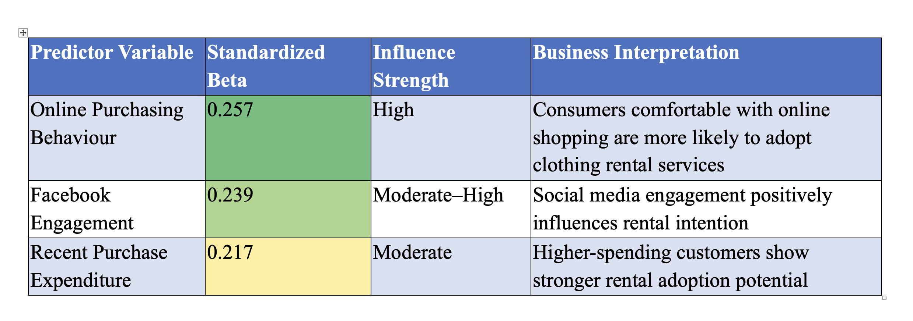
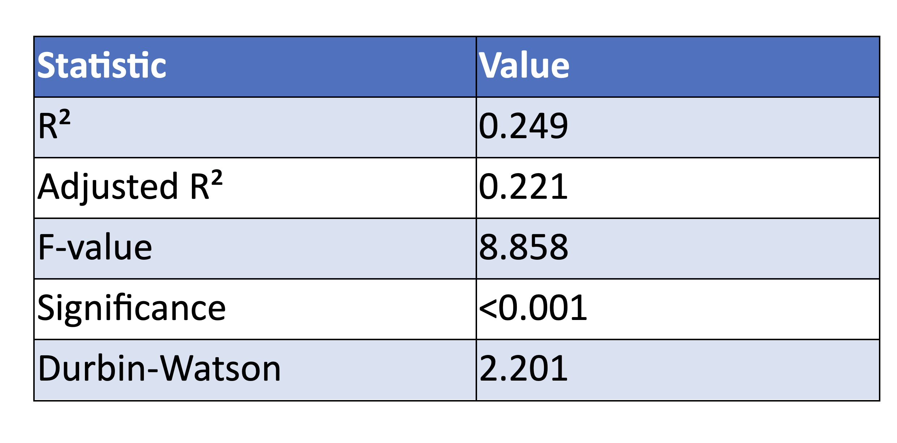

# Customer Segmentation & Clothing-Rental Adoption — Luna7

**SPSS | Marketing Analytics | K-Means Clustering | Multiple Regression**

## Project overview

**Luna7** is a fictional retailer considering a clothing-rental service. This project uses customer behaviour, digital engagement and spending variables to investigate (1) which customer segments exist and (2) which behaviours are associated with interest in renting clothing.

This repository documents the **two-segment and regression** version of the original MSc Marketing Analytics analysis. A separate assignment version explored a *three-cluster* solution; results from the two versions have **not** been combined.

## Business questions

- Which groups of customers appear most promising for an initial clothing-rental pilot?
- Are digital purchasing behaviour, social-media engagement and spending related to rental intention?
- How should marketing activity differ between more-engaged and less-engaged customers?

## Dataset overview

| Item | Project report |
|---|---:|
| Initial customer observations | 265 |
| Complete cases used for multivariate analysis | 223 |
| Final segmentation documented here | 2 clusters |
| Regression model R² | 0.249 |

The dataset is educational/coursework material, not live customer data from an operating company. The original raw dataset and SPSS syntax/output files are not currently available in this repository.

## Methodology

1. Screened missing values and used listwise deletion for complete-case analysis.
2. Explored distributions and descriptive statistics.
3. Standardised clustering variables as z-scores before segmentation.
4. Examined exploratory hierarchical clustering/dendrogram output, then used K-means to interpret two customer segments.
5. Applied multiple regression to rental intention and reviewed model diagnostics.
6. Translated the observed patterns into possible targeting strategies.

See [methodology](analysis/methodology.md) for additional details and limitations.

## Results and visuals

### Rental intention

Customer preferences and expressed rental interest are investigated as inputs to targeting decisions; intention should not be confused with observed subscription purchases.

### Regression analysis

The original report identifies online purchasing behaviour, Facebook engagement and recent expenditure as positively associated with rental intention. The full model explains approximately **24.9%** of variation in the reported outcome (R² = 0.249).

## Business interpretation

- More-engaged online customers provide a logical initial audience for a pilot and digital messaging.
- Digital engagement, purchasing habits and spending may be useful inputs to targeting, but **association is not causation**.
- Lower-engagement customers may require awareness, reassurance and a different value proposition before a rental offer is prioritised.
- A real rollout should validate survey intention against actual trial conversion, repeat rental and customer value.

Read the [business recommendations](documentation/business_recommendations.md).

## Files and reproducibility

- [`images/`](images/) — exported analysis visuals.
- [`Analysis/methodology.md`](Analysis/methodology.md) — analysis design, variables, statistical methods and limitations.
- [`documentation/business_recommendations.md`](documentation/business_recommendations.md) — decision-oriented recommendations and proposed evaluation KPIs.

**Reproducibility note:** This is currently a **documented SPSS analysis**, not a fully reproducible code repository. If the permitted dataset and SPSS syntax are recovered, they can be added; any future Python/SQL implementation should be clearly labelled a separate reanalysis.
